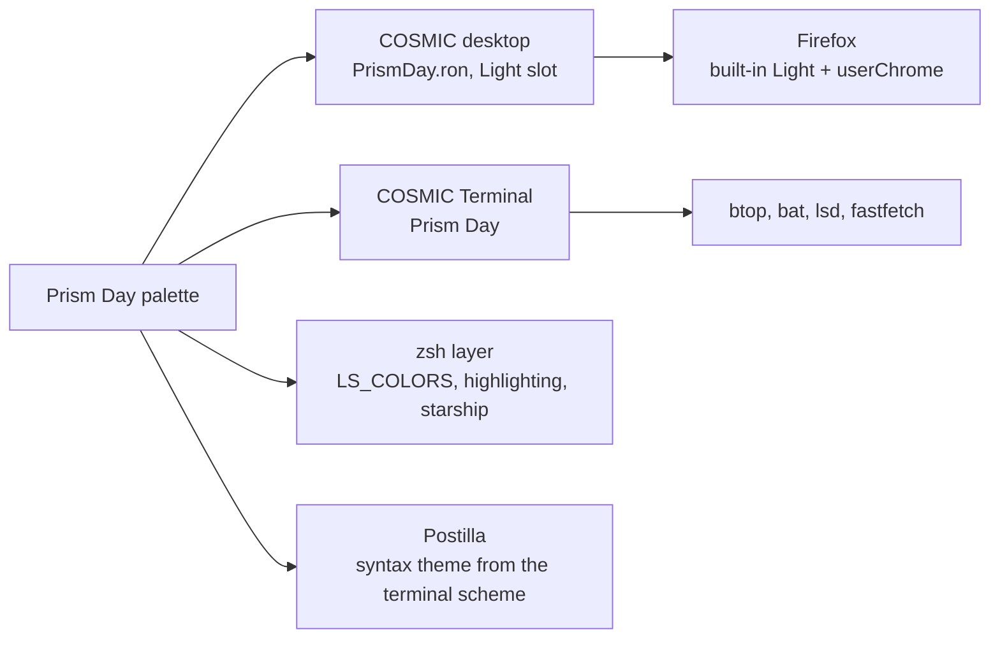

# Prism Day

> Frost, navy and petal pink, with ruby kept for what is wrong. Light through a cut stone, by day.

Pop!_OS 24.04 on the COSMIC desktop, one palette carried through the whole
machine: desktop, terminal, shell, editor, browser. This note is the rice
describing itself, written in Markdown and rendered by **Postilla**.

## Palette

Every text colour is checked against the window background  `#DFEAEC`.

| Role | Hex | Contrast on background |
|------|-----|------------------------|
| Text |  `#242B3D` | 11.5:1 |
| Petal, accent |  `#804C4F` | 5.6:1 |
| Coral, warning |  `#963E36` | 5.6:1 |
| Ruby, error |  `#B52817` | 5.2:1 |
| Azure, success |  `#2347A9` | 6.7:1 |
| Ice, symlinks |  `#526664` | 5.0:1 |
| Teal, directories |  `#306B65` | 5.0:1 |
| Muted |  `#515B7C` | 5.5:1 |

Containers sit one step away from the background at  `#EEF8F9`, which is
what frosted glass blurs into.

## Where the colours go



## Setup, in order

- [x] Import `cosmic/PrismDay.ron` into Appearance, **Dark** slot
- [x] Import `cosmic-term/PrismDay-term.ron`, pick **Prism Day** for the profile
- [x] `./icons/install.sh` for the **Cosmic-PrismDay** icons, `./cosmic/install.sh` for fonts and the terminal look
- [x] `./zsh/install.sh`, `./lsd/install.sh`, `./fastfetch/install.sh`
- [x] Cursor: Oxygen-PrismDay-Petal
- [x] Wallpaper: `backgrounds/prismday-anime.png`
- [ ] Screenshot for the README

## The baseline every rice shares

```ron
corner_radii: (
    radius_xs: (2.0, 2.0, 2.0, 2.0),   // squared corners
    radius_xl: (2.0, 2.0, 2.0, 2.0),
),
frosted: Low,
frosted_windows: true,
frosted_panel: true,
frosted_applets: true,
frosted_maximized_apps: false,
gaps: (0, 7),
active_hint: 1,
```

Contrast is the WCAG ratio[^1], where $L$ is relative luminance:

```typst
$ (L_1 + 0.05) / (L_2 + 0.05) >= 4.5 $
```

---

*Rendered in Postilla, a Markdown notes app for COSMIC. The window is painted
with this rice's terminal scheme, imported as a syntax theme.*

[^1]: Web Content Accessibility Guidelines, success criterion 1.4.3. Normal text wants 4.5:1, large text 3:1.
